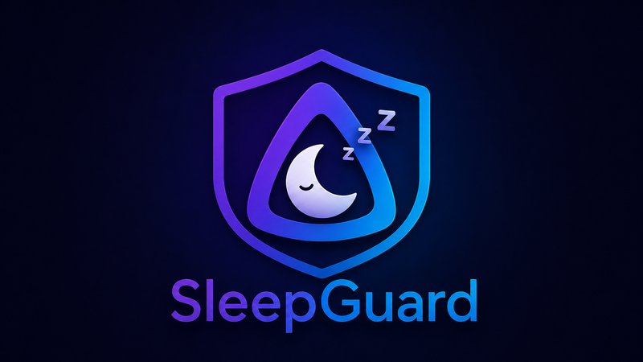

<div align="center">
  <div style="display: flex; padding-block: 40px; margin-bottom: 20px; justify-content: center; background-color: #1f1f1f">
    <picture>
      
    </picture>
  </div>
</div>

# [SleepGuard for Jellyfin](https://github.com/thisispivi/JellyfinSleepGuard)

A Jellyfin server plugin, written in C# on .NET 10, that pauses or stops
playback when a session looks like it has turned into an overnight autoplay
run. An optional "Are you still watching?" overlay for Jellyfin Web is written
in TypeScript and loaded through a JavaScript Injector plugin.

       

To use the plugin, follow [Install SleepGuard](#install-sleepguard). The
[architecture notes](./docs/ARCHITECTURE.md) explain how it works inside.

## Tech Stack

- **Plugin**: C# on .NET 10, built against the Jellyfin 12 server packages.
- **Overlay**: TypeScript in strict mode with no runtime dependencies, compiled
  by `tsc` and embedded in the plugin DLL.
- **Tests**: xUnit v3.
- **CI and releases**: GitHub Actions.

## Features

### Server-side limits

- Pause or stop playback after a continuous playback limit, set in minutes.
- Pause or stop after a number of autoplay episodes.
- A grace period between the prompt and the final pause or stop.
- Optional filters by user and media type, a night-only time window, and
  custom prompt text.
- The pause or stop still fires when the browser overlay is not installed.

### Browser overlay

- An "Are you still watching?" prompt in Jellyfin Web.
- A solid background, a custom image URL, or the now-playing artwork.
- Adjustable colors, buttons, artwork dimming and blur, and panel opacity,
  with a live preview on the settings page.

### Test mode

- A short continuous-time limit in seconds, a dry run that sends no command,
  and logging of every rule check.

## Getting Started

Users install the plugin from the plugin repository; see
[Install SleepGuard](#install-sleepguard). To build it from source you need the
.NET 10 SDK and Node 22. SleepGuard targets Jellyfin 12; servers on 10.11 stay
on SleepGuard 0.1.0.22.

```powershell
git clone https://github.com/thisispivi/JellyfinSleepGuard.git
cd JellyfinSleepGuard
dotnet build Jellyfin.Plugin.SleepGuard.sln
dotnet test Jellyfin.Plugin.SleepGuard.sln
```

`dotnet build` also compiles the TypeScript overlay. To build only the overlay:

```powershell
cd client
npm ci
npm run check
npm run build
```

## Install SleepGuard

1. Open Jellyfin: `Dashboard -> Plugins -> Repositories`.
2. Add this repository URL:

   ```text
   https://github.com/thisispivi/JellyfinSleepGuard/releases/latest/download/manifest.json
   ```

3. Install SleepGuard from the plugin catalog.
4. Restart Jellyfin.
5. Open `Dashboard -> Plugins -> SleepGuard`.

The default settings work without changes: playback pauses after 2 hours of
continuous play or after 3 autoplay episodes.

## Basic settings

Open `Dashboard -> Plugins -> SleepGuard`.

- Enable SleepGuard.
- Choose whether SleepGuard should `Pause` or `Stop`.
- Set the continuous playback limit in minutes.
- Set the autoplay episode limit.
- Set the grace period, which is the delay between the prompt and the final
  pause or stop.

The Advanced section holds user filtering, media type filtering, a night-only
time window, and custom prompt text.

## Appearance settings

Open `Dashboard -> Plugins -> SleepGuard -> Appearance` to customize the
browser overlay.

- Choose a solid background, a custom image URL, or the default now-playing
  artwork background.
- In artwork mode, SleepGuard reads Jellyfin Web metadata on a best-effort
  basis: series backdrop first, then item backdrop, then primary image.
- Adjust the fallback background, overlay text, continue button, dismiss
  button, artwork dimming, artwork blur, and prompt panel opacity.
- Check the look in the live preview before saving.

Artwork backgrounds need the Jellyfin Web client to expose current playback
metadata to the injected script. When that metadata is missing, SleepGuard
falls back to the configured solid background without an error.

## Overlay setup

SleepGuard serves its browser overlay at this Jellyfin server endpoint:

```text
/SleepGuard/overlay.js
```

If Jellyfin runs under a URL prefix, for example `/jellyfin/jellyfin`, the real
URL is under that prefix:

```text
/jellyfin/jellyfin/SleepGuard/overlay.js
```

The overlay is installed only through a JavaScript Injector script entry. To
load it in Jellyfin Web:

1. Install a JavaScript Injector plugin for Jellyfin.
2. Open `Dashboard -> Plugins -> JavaScript Injector`.
3. Click `Add Script`.
4. Name it `SleepGuard`.
5. Paste this code into the JavaScript code box:

   ```js
   (() => {
     const endpoint = "SleepGuard/overlay.js";
     const getOverlayUrl = () => {
       if (window.ApiClient && typeof window.ApiClient.getUrl === "function") {
         return window.ApiClient.getUrl(endpoint);
       }

       const webIndex = window.location.pathname.toLowerCase().indexOf("/web");
       const basePath =
         webIndex >= 0 ? window.location.pathname.slice(0, webIndex) : "";
       return window.location.origin + basePath + "/" + endpoint;
     };

     if (document.querySelector('script[data-sleepguard-overlay="true"]'))
       return;

     const script = document.createElement("script");
     script.dataset.sleepguardOverlay = "true";
     script.src = getOverlayUrl();
     script.defer = true;
     script.onerror = () =>
       console.warn("[SleepGuard] Failed to load overlay script:", script.src);
     document.head.appendChild(script);
   })();
   ```

6. Enable the script.
7. Save.
8. Refresh Jellyfin Web in your browser.

## Testing your setup

These steps confirm SleepGuard works without waiting hours.

1. Install SleepGuard and restart Jellyfin.
2. Install a JavaScript Injector plugin.
3. Add the SleepGuard loader script from [Overlay setup](#overlay-setup).
4. Refresh Jellyfin Web.
5. Start playing a video in Jellyfin Web.
6. Open browser developer tools and run:

   ```js
   window.SleepGuardOverlay;
   ```

   If the overlay script loaded, this returns an object with `show`, `hide`,
   and `settings`.

7. In `Dashboard -> Plugins -> SleepGuard -> Test Mode`:
   - Enable test mode.
   - Set `Continuous seconds` to `15`.
   - Enable `Dry run`.
   - Enable `Log rule checks`.
   - Save.

8. Play something for at least 15 seconds.
9. Check the Jellyfin server log. The continuous-time rule should fire, followed
   by a dry-run line saying SleepGuard would send the pause or stop command.

When you finish testing, disable test mode or set `Continuous seconds` back to
`0`.

## Troubleshooting

| Problem                                    | What to check                                                                                                                                         |
| ------------------------------------------ | ----------------------------------------------------------------------------------------------------------------------------------------------------- |
| Overlay does not appear                    | Confirm the JavaScript Injector script is enabled, then refresh Jellyfin Web.                                                                         |
| `window.SleepGuardOverlay` is undefined    | The loader script did not run or the overlay failed to load. Check the browser console.                                                               |
| `404` on `/SleepGuard/overlay.js`          | If Jellyfin is under a URL prefix, replace the old loader snippet with the current one above. Also rebuild/reinstall SleepGuard and restart Jellyfin. |
| Prompt appears but playback does not pause | Check whether the client accepts Jellyfin remote pause/stop commands.                                                                                 |
| Nothing happens during testing             | Enable dry run and rule-check logging, then watch the Jellyfin server log while a video plays.                                                        |
| Too many logs                              | Turn off `Log rule checks` after testing.                                                                                                             |

Useful log lines:

| Log line                             | Meaning                                                  |
| ------------------------------------ | -------------------------------------------------------- |
| `SleepGuard session monitor started` | SleepGuard loaded.                                       |
| `Rule ContinuousTimeRule fired`      | The continuous-time limit was reached.                   |
| `Rule AutoplayEpisodeRule fired`     | The autoplay episode limit was reached.                  |
| `SleepGuard sent prompt`             | Jellyfin accepted the prompt/toast request.              |
| `SleepGuard dry run`                 | Test mode dry run is on; no pause/stop command was sent. |
| `SleepGuard sent Pause command`      | SleepGuard sent the media-control command.               |
| `failed to send Pause command`       | The client did not accept the remote command.            |

## Development checks

Run the plugin checks from the repository root:

```powershell
dotnet format Jellyfin.Plugin.SleepGuard.sln --verify-no-changes
dotnet build Jellyfin.Plugin.SleepGuard.sln -c Release
dotnet test Jellyfin.Plugin.SleepGuard.sln -c Release --no-build
```

For overlay changes, also run `npm ci && npm run check` from `client/`.
[CODING_GUIDELINES.md](./CODING_GUIDELINES.md) is the coding standard.

## Deployment

SleepGuard ships through its GitHub releases. Each release attaches the plugin
zip and an updated `manifest.json`, the plugin repository manifest that lists
every published version. Jellyfin reads that manifest from the latest release:

```text
https://github.com/thisispivi/JellyfinSleepGuard/releases/latest/download/manifest.json
```

There is no GitHub Pages site. The committed `manifest.json` only seeds the
release manifest.

## Versioning and releases

Releases are automatic and follow [Semantic Versioning](https://semver.org/).
Every pull request that changes code bumps the version in `build.yaml`, as
[AGENTS.md](./AGENTS.md#versioning-and-releases) describes. When CI passes on
`main`, the Release workflow tags the new version, publishes the
[GitHub release](https://github.com/thisispivi/JellyfinSleepGuard/releases),
and attaches the plugin zip and the updated `manifest.json` to it. Dependabot
alerts and security updates are on; the `fix-vulnerabilities` skill triages
them.

## Project Structure

```text
.
├── src/Jellyfin.Plugin.SleepGuard/
│   ├── Rules/            Decide when a session crosses a limit
│   ├── Sessions/         Track playback per session
│   ├── Actions/          Prompt, pause, and stop
│   ├── Api/              Serve the overlay script
│   └── Configuration/    Settings and the dashboard page
├── tests/Jellyfin.Plugin.SleepGuard.Tests/   xUnit v3 tests
├── client/               TypeScript overlay for Jellyfin Web
├── docs/ARCHITECTURE.md  Internal design for contributors
├── images/logo.png       Plugin logo
├── build.yaml            Plugin metadata and version
└── manifest.json         Seed for the release manifest
```

## License

GPL-2.0-only. See [LICENSE](LICENSE).
